# Body

A minimal body measurement tracker for iPhone. Log your weight, body fat and tape measurements, see how they change on charts, and keep progress photos next to the numbers.

It's a web app you add to your home screen. No App Store, no account, no server: everything stays on your phone and works offline.

**[Try the demo →](https://tovahasi.github.io/body-tracker/?demo)**  ·  [Open the app](https://tovahasi.github.io/body-tracker/)

The demo is filled with six months of sample data (a lean bulk with monthly photos) and keeps it separate from the real app. Tap **Demo** in the top-left corner to reset it.

<p align="center">
  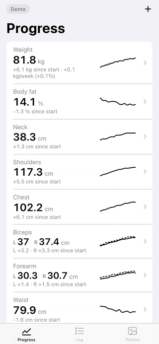
</p>

## Features

**Tracking**
- Weight, body fat, neck, shoulders, chest, waist, hips.
- Biceps, forearm, thigh and calf are logged **left and right** separately.
- Fill in only what you measured that day. Last values are shown as hints.
- Notes, and any past date for back-filling old measurements.

**Charts**
- Each measurement shows its latest value, the change since your first entry and a sparkline.
- Tap a measurement for a full chart with 1M / 3M / 6M / 1Y / All ranges. Drag a finger across it to read any date.
- Weight gets a smoothed trend line and your rate over the last 4 weeks, e.g. `+0.3 kg/week (+0.4%)`.
- Left/right measurements are drawn as two lines with the difference between sides.
- Days with progress photos are marked under the chart. Scrub to one to see the photo.

**Photos**
- Built-in camera with a **ghost overlay** of your previous photo, so you can match pose and distance. It also has a 3 s / 10 s timer.
- Or pick photos from your library. Photos are compressed on the device.
- Full-screen viewer with pinch and double-tap zoom.
- **Compare** two photos side by side or with a before/after **slider**, choosing any two dates.

**Backup**
- Export all measurements to a small file.
- Back up photos month by month, either as regular images to Photos or Files, or as a file you can import later.
- Months that are already backed up are marked.

## Screenshots

<table>
  <tr>
    <td align="center">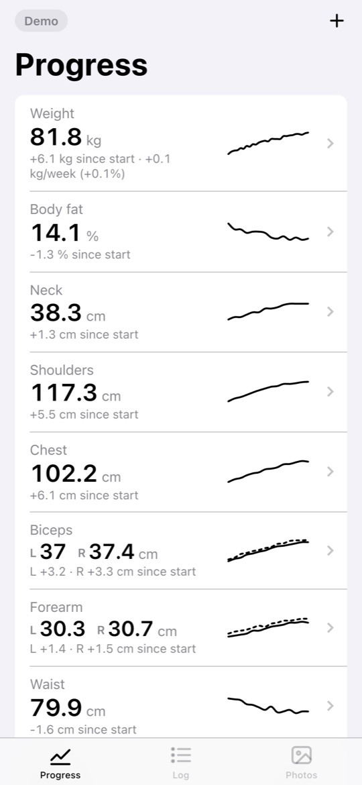<br><sub>Progress overview</sub></td>
    <td align="center">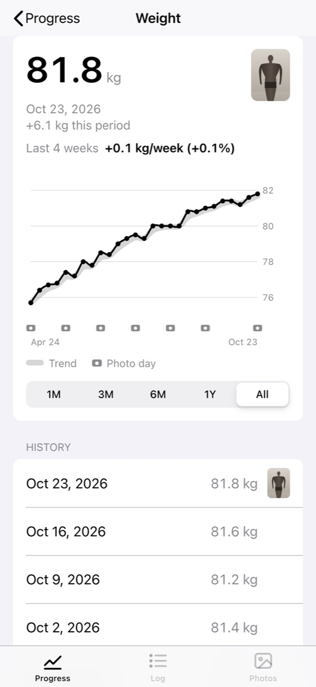<br><sub>Weight with trend and weekly rate</sub></td>
    <td align="center">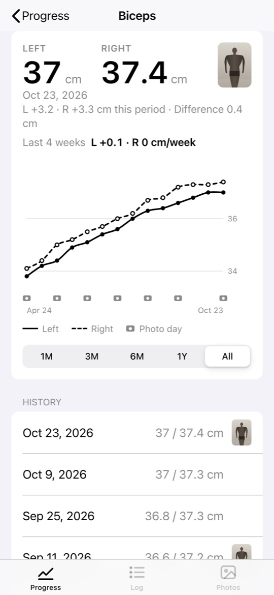<br><sub>Left and right biceps</sub></td>
  </tr>
  <tr>
    <td align="center">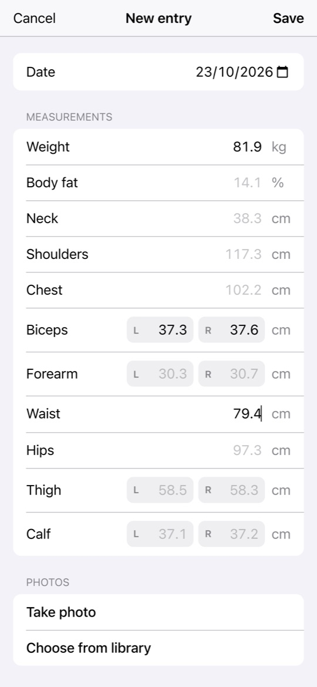<br><sub>New entry with last values as hints</sub></td>
    <td align="center">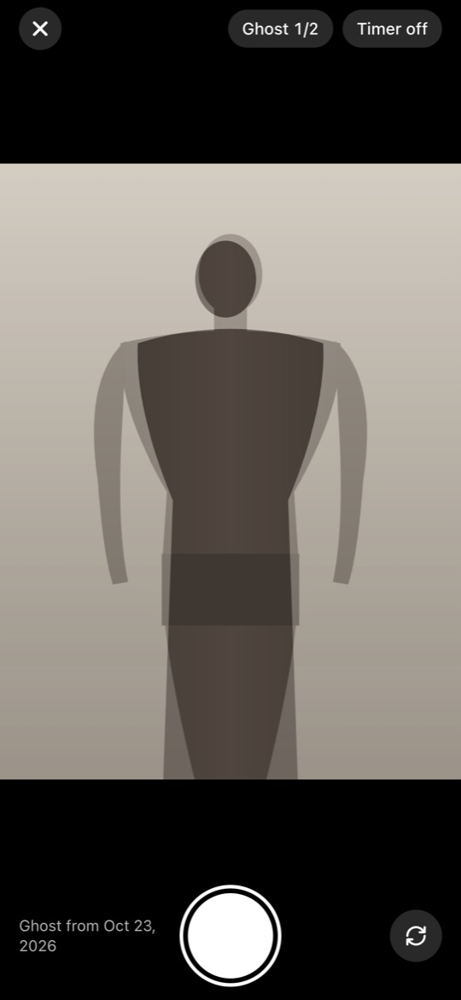<br><sub>Camera with ghost of the last photo</sub></td>
    <td align="center">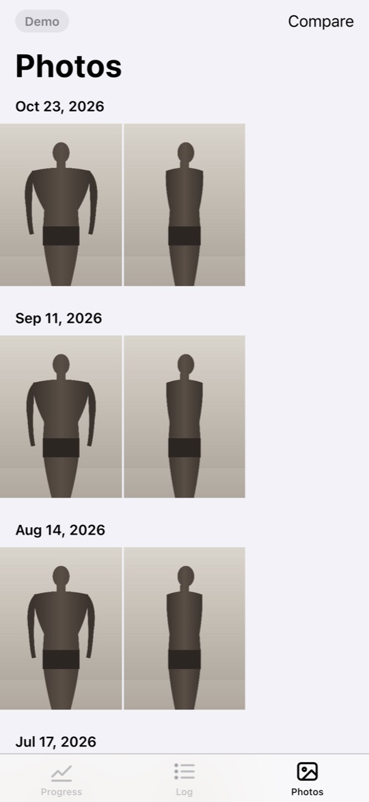<br><sub>Photos by date</sub></td>
  </tr>
  <tr>
    <td align="center">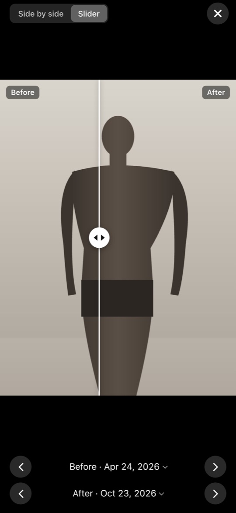<br><sub>Before/after slider</sub></td>
    <td align="center">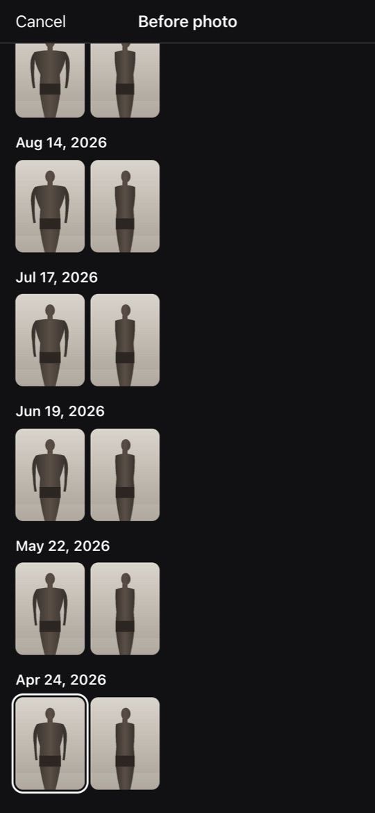<br><sub>Pick any two dates to compare</sub></td>
    <td align="center">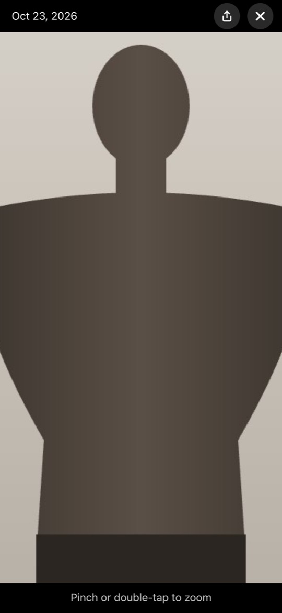<br><sub>Zoomed photo</sub></td>
  </tr>
  <tr>
    <td align="center">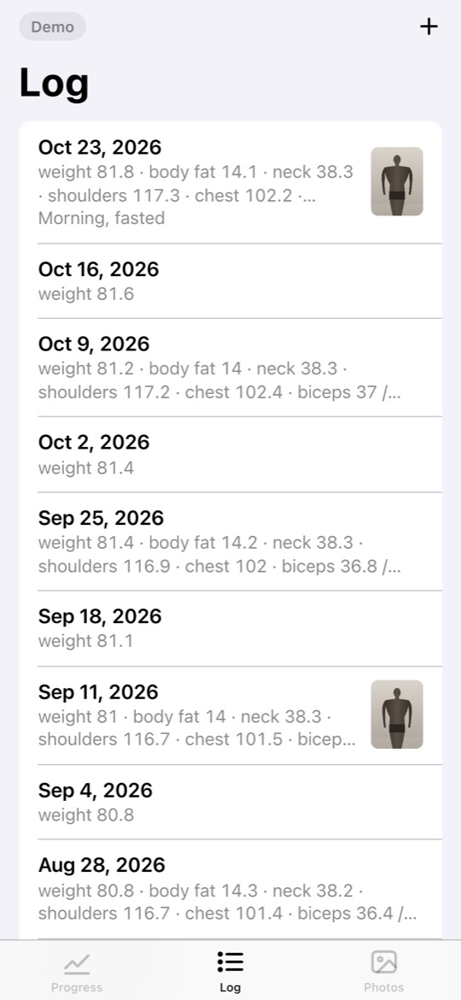<br><sub>Log of all entries</sub></td>
    <td align="center">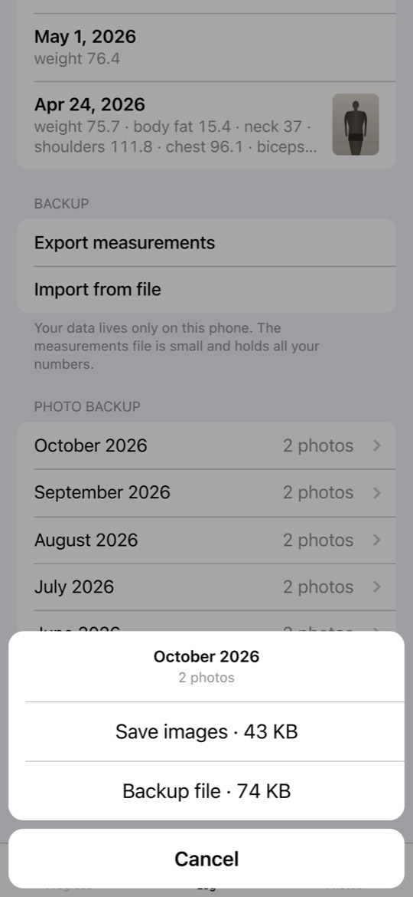<br><sub>Back up a month of photos</sub></td>
    <td align="center">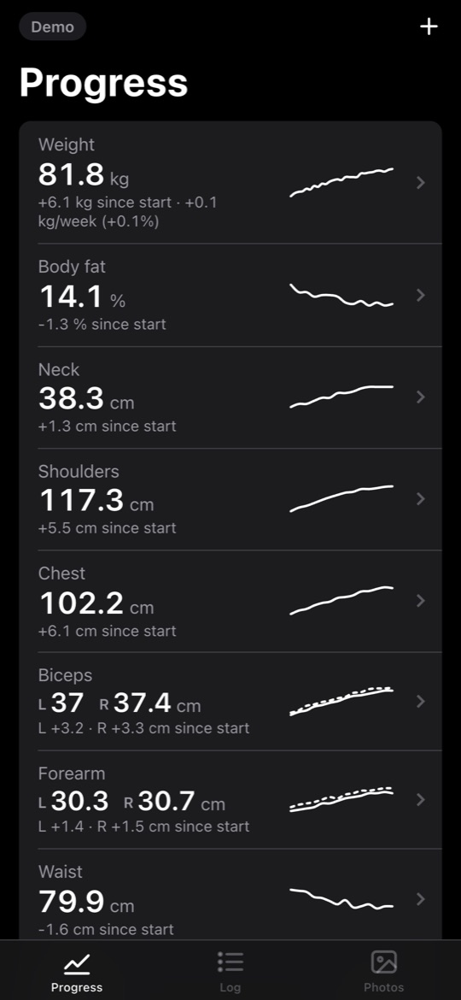<br><sub>Dark mode</sub></td>
  </tr>
</table>

Photos in the screenshots are generated silhouettes, and all numbers are sample data.

## Install on iPhone

1. Open [tovahasi.github.io/body-tracker](https://tovahasi.github.io/body-tracker/) in **Safari**.
2. Tap **Share**, then **Add to Home Screen**.
3. Launch **Body** from the home screen. It opens full screen, like a regular app.

The first launch needs internet. After that everything works offline, and updates load automatically when you're online.

## Your data

- **Measurements and photos are stored only on your phone**, in the app's own storage (IndexedDB). Nothing is uploaded anywhere. This repository contains only the app's code.
- Data stays when you restart the app or the phone, and when the app updates. It doesn't expire if you don't open the app for a while.
- **Deleting the home screen icon deletes the data**, and so may clearing website data in Safari settings. Use **Log → Backup** from time to time:
  - **Export measurements** saves all numbers to a small file.
  - **Photo backup** saves photos month by month, as images or as a file you can import.
  - **Import from file** restores data. You can select several files at once.
- There's no sync between devices. The home screen app and a Safari tab have separate storage.

## How it works

Plain HTML, CSS and JavaScript, with no framework, build step or dependencies.

| File | What it does |
|---|---|
| [`index.html`](index.html), [`manifest.webmanifest`](manifest.webmanifest) | App shell, home screen name, icon and full-screen mode |
| [`app.js`](app.js) | The whole app: storage, views, SVG charts, photo viewer, camera, backup |
| [`styles.css`](styles.css) | iOS-style layout with light and dark themes |
| [`sw.js`](sw.js) | Service worker: caches the app for offline use, network-first so updates arrive right away |
| [`demo.js`](demo.js) | Sample data for `?demo`, loaded only in demo mode |

- **Storage.** IndexedDB with three stores: `entries` (measurements), `photos` (metadata and ~30 KB thumbnails, loaded at start) and `fulls` (full-size photos, loaded only when shown).
- **Photos** are resized to 2000 px and re-encoded as JPEG with a canvas before saving, so 150 photos take tens of megabytes.
- **Charts** are hand-drawn SVG: smoothed lines, a 7-day exponential moving average for the weight trend, and a least-squares slope for the weekly rate.
- **Camera** uses `getUserMedia`. Front camera shots are saved mirrored, as previewed, so the ghost overlay always lines up.

## Run locally

```sh
python3 -m http.server 8765
```

Open http://localhost:8765 for the app, or http://localhost:8765/?demo for the demo. When you change files, bump `CACHE` in `sw.js` so the offline cache refreshes.

The [`ios/`](ios/) folder holds an early native SwiftUI version. The web app doesn't need it.
